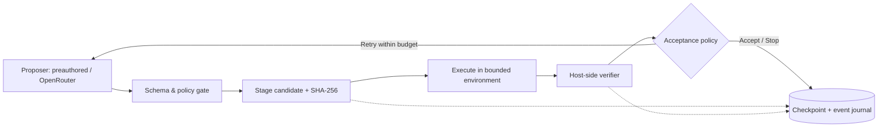

# Loop Engineering · Two Verifiable Agent Loops

**A runnable reference implementation of proposal → execution → independent verification → selection/stop.**

This repository accompanies the *Loop Engineering: Formalization, Core Architectures, and Applications in Autonomous R&D* research keynote. It is a **public, educational, reproducible implementation**, not a benchmark, a production autonomous research platform, or a demonstration that an LLM always succeeds.

The project contains exactly two experiments:

| | Demo 1 — Software Engineering | Demo 2 — Scientific Research |
|---|---|---|
| Task | Repair a transaction ledger | Improve a synthetic binary classifier |
| Proposer | Prepared offline patches **or** OpenRouter model | Prepared offline configurations **or** OpenRouter model |
| Executor | Isolated Python candidate; Docker **required for model-produced code** | Trusted, fixed Python training code; only bounded hyperparameters/features are proposed |
| Evidence | 5 public checks → 10 separate acceptance checks | Training → validation F1 → one held-out evaluation after selection |
| Decision | `ACCEPTED`, `RETRY`, `BUDGET_EXHAUSTED` or `ESCALATED` | Strict best-so-far validation selection; bounded `SEARCH_COMPLETE` |
| Main lesson | Public tests passing does not establish full correctness | Best-so-far increasing does not prove convergence or generalization |

## Architecture at a glance



The **proposer cannot write the acceptance policy**. For Demo 1, model-generated code must execute in a restricted Docker container; for Demo 2, the model proposes only numerical configurations interpreted by trusted code. [Read the trust-boundary details](docs/ARCHITECTURE.md).

## Quick start — no account or model required

**Requirements:** Python 3.10+; no third-party runtime Python packages for the reference runs.

```bash
python -m venv .venv
# macOS/Linux: source .venv/bin/activate
# Windows PowerShell: .venv\Scripts\Activate.ps1
python -m pip install -e .

loopeng se --backend offline --mode governed --live
loopeng rd --backend offline --mode governed --seed 2026 --live
```

Both runs create a new unique run ID under `runs/` (ignored by Git). `summary.json` contains the result, `state.json` the checkpoint, `events.jsonl` the journal. The research run also saves `trajectory.csv`, `trajectory.svg`, and `experiment_manifest.json`.

**These offline proposals are preauthored for pedagogy.** They exercise real verification, state and selection logic, but do **not** measure an autonomous LLM's ability to discover fixes or research hypotheses.

### Reference results — reproducible, not live model claims

**Demo 1:** the preauthored run accepts the third attempt:

| Attempt | Public checks | Acceptance checks | Decision |
|---|---|---|---|
| 1 | FAIL | NOT RUN | Continue |
| 2 | PASS | FAIL | Reject / retry |
| 3 | PASS | PASS | `ACCEPTED` |

Try the ablations (each creates its own run):

```bash
loopeng se --backend offline --mode single_pass
loopeng se --backend offline --mode feedback_only
loopeng se --backend offline --mode governed
```

The feedback-only configuration accepts attempt 2 using public tests despite failing acceptance checks. That counterexample concerns the **acceptance policy for these prepared candidates**; it is not a statistical claim about the capabilities of a language model.

**Demo 2:** fixed synthetic data and seed `2026`; baseline validation F1 is approximately `0.6309`, best validation F1 is approximately `0.8734` after five prepared hypotheses, and selected-model held-out F1 is approximately `0.8828` (baseline held-out ≈ `0.6483`). The held-out split is not consulted during search. A single synthetic seed is not evidence of general ML superiority.

```bash
loopeng rd --backend offline --mode single_pass --seed 2026
loopeng rd --backend offline --mode governed --seed 2026
```

## Run with a real model through OpenRouter

Live mode requires an OpenRouter API key and a specific model supporting JSON Schema structured outputs. **API calls may incur charges.** See **[OpenRouter setup](docs/OPENROUTER.md)** for macOS/Linux, Windows, preflight, model selection, Docker and troubleshooting. Never paste your key into a Git repository or issue.

Once configured:

```bash
loopeng preflight                 # GET-only, no inference
loopeng preflight --probe         # ONE billable, strict-schema inference

loopeng rd --backend openrouter --mode governed --max-attempts 3 --live

# Docker must be installed and python:3.12-slim pulled first.
loopeng se --backend openrouter --sandbox docker --mode governed --max-attempts 3 --live
```

A successful probe checks transport and response shape, **not** model quality. Live attempts, latency, outcomes and cost depend on the account, selected model, provider and runtime. They are not guaranteed to reproduce the offline fixture results.

### Inspect the evidence

```bash
loopeng report runs/<run-id>
# Or read runs/<run-id>/events.jsonl and runs/<run-id>/summary.json
```

**One trust boundary, two different forms of evidence:** The ledger demo verifies finite input/output behavior, not universal program correctness. The research demo selects on validation, not a held-out benchmark, and terminates by budget, not proof of convergence.

## Technical notes

- [Architecture and invariant checks](docs/ARCHITECTURE.md)
- [OpenRouter setup and troubleshooting](docs/OPENROUTER.md)
- [Reproducibility, measurement and scope](docs/EXPERIMENTS.md)
- [Security model and limitations](SECURITY.md)

### Project layout

```text
loop-engineering-demos/
├── .github/workflows/ci.yml
├── .env.example
├── .gitignore
├── LICENSE
├── README.md
├── SECURITY.md
├── pyproject.toml
├── docs/
│   ├── ARCHITECTURE.md
│   ├── EXPERIMENTS.md
│   └── OPENROUTER.md
├── src/loopeng/
│   ├── cli.py              # public command-line interface
│   ├── core.py             # bounded state, journal, checkpoint
│   ├── backends.py         # OpenRouter; no key in candidate container
│   ├── sandbox.py          # public/acceptance verification
│   ├── demo_se/            # ledger specification, proposals, execution
│   └── demo_rd/            # synthetic dataset, classifier, experiment search
└── tests/                  # offline contract/security/regression tests
```

## Testing

```bash
python -m unittest discover -s tests -v
```

CI runs this test suite without external credentials or an API network call. The code uses Python standard library only. The **Docker path is not exercised by CI**, and should be validated on your platform before running model-generated code.

## License and citation

MIT License; see [LICENSE](LICENSE). If you refer to the ideas behind this code, cite the relevant primary research rather than treating these reference demos as a peer-reviewed evaluation. A short bibliography and the distinction between our results and external research are in [docs/EXPERIMENTS.md](docs/EXPERIMENTS.md).
